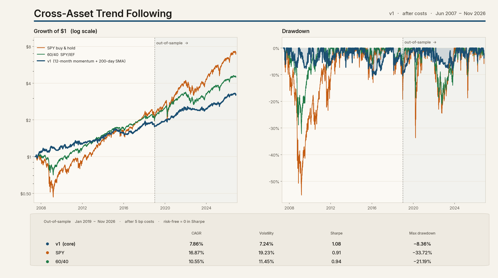
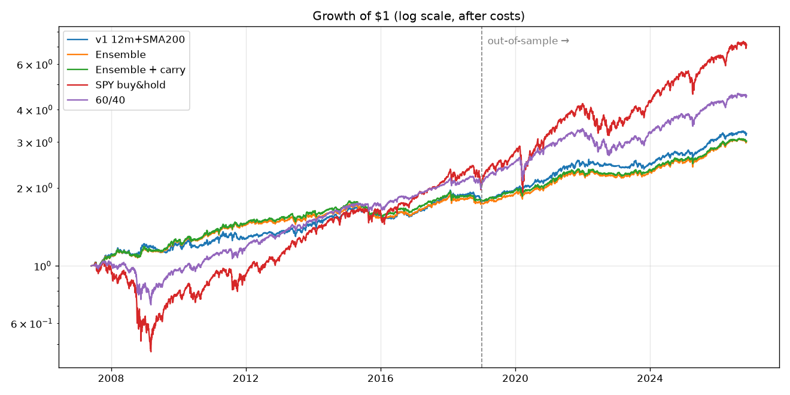
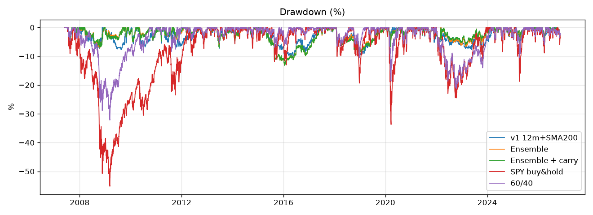
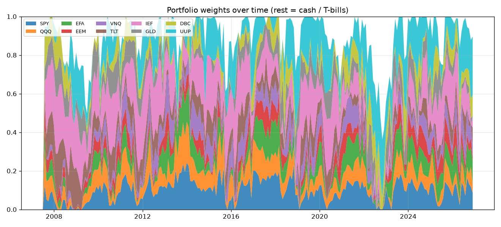
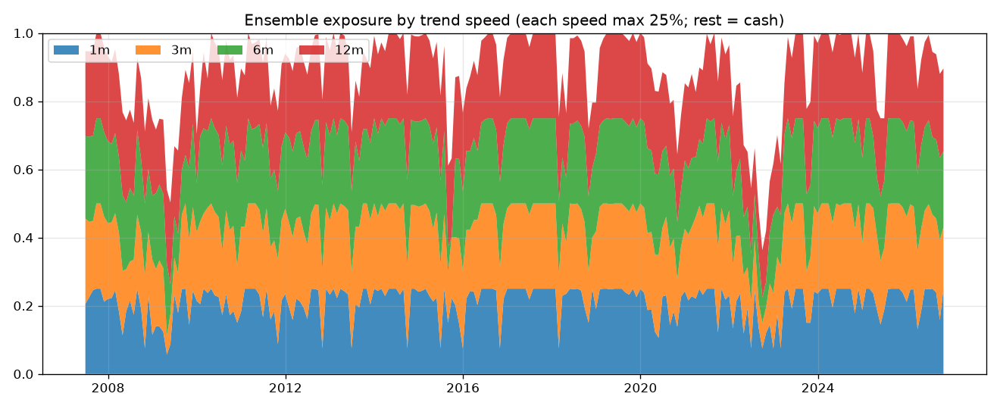

# Cross-Asset Trend Following

[](https://www.python.org/)
[](https://github.com/chanwuii/cross-asset-trend/actions/workflows/tests.yml)
[](LICENSE)

A small, fully reproducible **mini-CTA**. It trend-follows 10 liquid ETFs covering stocks, bonds, gold, commodities and the US dollar, the way managed-futures funds do.

The **core strategy is v1**: 12-month time-series momentum plus a 200-day moving-average filter, inverse-volatility sizing, a 10% volatility target, monthly rebalance, and next-day execution. Later experiments — a multi-speed ensemble, a carry overlay, and a Google Trends overlay — did not improve returns in a meaningful way, so they are kept as documented A/B tests rather than as the default.



**Out-of-sample (Jan 2019 – Nov 2026, after 5 bp costs)**

| Strategy | CAGR | Vol | Sharpe | Max DD |
|---|---:|---:|---:|---:|
| **v1 (core)** | **7.86%** | **7.24%** | **1.08** | **−8.36%** |
| SPY buy & hold | 16.87% | 19.23% | 0.91 | −33.72% |
| 60/40 SPY/IEF | 10.55% | 11.45% | 0.94 | −21.19% |

v1 earns less than the benchmarks, with about one-third of SPY's volatility and a much smaller drawdown. Sharpe is computed with a risk-free rate of 0. This is research code, not investment advice. The main backtest is `python run.py --v1`.

| Version | What it is | Research question | Answer so far |
|---|---|---|---|
| **v1 (core)** | **12-month momentum + 200-day SMA** | Does Google search attention help? | No meaningful effect |
| v2 | Multi-speed ensemble (1/3/6/12 months), optional carry tilt | Does combining speeds or adding carry help? | Slightly higher Sharpe only because volatility ran below target; lower CAGR. Carry: no meaningful effect |

## Motivation

Most beginner trading projects backtest one stock with one indicator and report a flattering equity curve. I wanted to build the structure that professional trend followers use (diversified, risk-sized, cost-aware, out-of-sample tested) and then test well-known ideas against it with a fixed, pre-registered rule. A "no effect" result counts as a real finding.

## How v1 works

- **Universe (10 ETFs):**
  - US equities: SPY, QQQ
  - International equities: EFA, EEM
  - REITs: VNQ
  - Treasuries: TLT, IEF
  - Gold: GLD
  - Commodities: DBC
  - US dollar: UUP

  Uninvested money earns the T-bill ETF **BIL**.
- **Signal:** long an asset if its 12-month return is > 0 **and** its price is above the 200-day SMA. Long or cash only; no shorts.
- **Sizing:** inverse-volatility weights across active assets (63-day vol), scaled to a **10% annual volatility target** using the trailing covariance. No leverage (gross ≤ 100%), each ETF capped at 30%.
- **Execution:** the signal uses the close of the last trading day of the month (t). Trades fill at the **next day's close (t+1)**. Unit tests shock future prices and check that past decisions do not change.
- **Costs:** 5 bps per unit of turnover.
- **Split:** in-sample Jun 2007 → Dec 2018, out-of-sample Jan 2019 → Nov 2026. Data runs through 2026-11-11.
- **Benchmarks:** SPY buy & hold, and 60/40 SPY/IEF rebalanced monthly, run on the same engine with the same costs.

`python run.py --v1` regenerates `output/v1/` byte-for-byte from the cached data.

**Sensitivity** (`output/v1/sensitivity.csv`): across lookbacks of 3/6/12 months × SMA 100/200 days, Sharpe ranged 0.56–0.77 in-sample and 1.07–1.15 out-of-sample. The result does not hinge on one parameter.

## Full results (after costs, run 2026-11-12)

Source: `output/v1/metrics.csv`, `output/v2/metrics.csv` and `output/v2/ab_tests.csv`.

**In-sample (2007-06 → 2018-12)**

| Strategy | CAGR | Vol | Sharpe | Sortino | Max DD | Calmar | Turnover/yr | Costs/yr | Avg invested |
|---|---:|---:|---:|---:|---:|---:|---:|---:|---:|
| v1 12m + SMA200 | 5.15% | 8.05% | 0.66 | 0.92 | −10.62% | 0.48 | 399% | 0.20% | 88% |
| Ensemble 1/3/6/12m | 4.92% | 6.86% | 0.74 | 1.03 | −13.33% | 0.37 | 442% | 0.22% | 90% |
| Ensemble + carry | 5.15% | 6.83% | 0.77 | 1.08 | −13.27% | 0.39 | 431% | 0.22% | 88% |
| SPY buy & hold | 6.60% | 19.95% | 0.42 | 0.59 | −55.19% | 0.12 | 9% | 0.00% | 99% |
| 60/40 SPY/IEF | 6.44% | 10.73% | 0.64 | 0.91 | −32.19% | 0.20 | 34% | 0.02% | 99% |

**Out-of-sample (2019-01 → 2026-11)**

| Strategy | CAGR | Vol | Sharpe | Sortino | Max DD | Calmar | Turnover/yr | Costs/yr | Avg invested |
|---|---:|---:|---:|---:|---:|---:|---:|---:|---:|
| v1 12m + SMA200 | 7.86% | 7.24% | 1.08 | 1.51 | −8.36% | 0.94 | 393% | 0.20% | 85% |
| Ensemble 1/3/6/12m | 7.18% | 6.44% | 1.11 | 1.55 | −7.17% | 1.00 | 434% | 0.22% | 89% |
| Ensemble + carry | 6.94% | 5.93% | 1.16 | 1.63 | −6.71% | 1.03 | 424% | 0.21% | 86% |
| SPY buy & hold | 16.87% | 19.23% | 0.91 | 1.29 | −33.72% | 0.50 | 0% | 0.00% | 100% |
| 60/40 SPY/IEF | 10.55% | 11.45% | 0.94 | 1.33 | −21.19% | 0.50 | 24% | 0.01% | 100% |

Full period (2007-06 → 2026-11), CAGR / Sharpe / Max DD:
- v1: 6.23% / 0.82 / −10.62%
- Ensemble: 5.83% / 0.88 / −13.33%
- Ensemble + carry: 5.87% / 0.91 / −13.27%
- SPY: 10.64% / 0.61 / −55.19%
- 60/40: 8.08% / 0.76 / −32.19%

## Experiments

### Multi-speed ensemble (v2)

Four small long/cash strategies, one per lookback (**1, 3, 6, 12 months**):
- **Signal:** an asset is long if its own return over that lookback is > 0 (time-series momentum). No skip-month at any speed; a 1-month lookback cannot skip a month, and one rule for all speeds keeps it simple. The 200-day SMA filter is not used at these speeds.
- **Sizing:** each speed is sized exactly like v1 (inverse vol → 10% vol target → caps).
- **Ensemble:** the ensemble holds the **equal-weight average** of the four target portfolios, w = (w₁ + w₃ + w₆ + w₁₂)/4.
  - The weights are fixed in advance; nothing was grid-searched.
  - An asset liked by only 1 of 4 speeds gets about ¼ of a full position.
  - Caps and the no-leverage limit still hold after averaging (unit-tested).

### Carry overlay (A/B experiment)

Carry is what an asset earns *if prices do not move*, measured **relative to cash (3-month T-bill, ^IRX)**. Every series is point-in-time, built only from values known on the signal date:

| Asset | Carry definition | Source |
|---|---|---|
| SPY, QQQ, EFA, EEM, VNQ | trailing-12-month dividends (ex-date ≤ t) / raw close − T-bill | yfinance dividends + unadjusted closes |
| TLT | 30-year Treasury yield (^TYX) − T-bill | yfinance |
| IEF | 10-year Treasury yield (^TNX) − T-bill | yfinance |
| UUP | US short rate − weighted foreign short rate (EUR via Germany 57.6, JPY 13.6, GBP 11.9, CAD 9.1; DXY weights renormalised). Month M is treated as known only from the start of month M+2 (publication lag) | OECD "immediate rates" (overnight/call money) via FRED: IRSTCI01{US,DE,JP,GB,CA}M156N |
| DBC | **skipped (no tilt)**. Roll yield needs prices of expired futures contracts, which Yahoo does not keep. TODO | none |
| GLD | **no tilt**. GLD holds physical gold, so there is no roll yield. A futures-style "lease rate − T-bill" has no free history (a YOUR TURN exercise explores −T-bill) | none |
| BIL | cash, never tilted | none |

**Pre-specified rule (written before running and not tuned):** for each asset the ensemble holds, positive carry ("agrees" with the long trend) multiplies its inverse-vol weight by **1.25**, negative carry ("disagrees") by **0.75**, and unknown carry by 1.0. The vol target and caps are then re-applied, so the tilt is relative within the basket. The rule changed the weight in 94.5% of held asset-months, i.e. on every held asset with carry data.

**A/B difference tests** (t-test on daily return differences; |t| < ~2 means the difference could easily be luck):

| Comparison | Period | Mean diff / yr | Tracking error | t-stat |
|---|---|---:|---:|---:|
| Ensemble − v1 | In-sample | −0.30% | 3.00% | −0.34 |
| Ensemble − v1 | Out-of-sample | −0.68% | 2.75% | −0.70 |
| Ensemble + carry − Ensemble | In-sample | +0.22% | 0.72% | +1.02 |
| Ensemble + carry − Ensemble | Out-of-sample | −0.26% | 0.92% | −0.80 |
| Ensemble + carry − Ensemble | Full | +0.02% | 0.81% | +0.13 |

### Reading the experiments honestly

- **Ensemble vs v1: smoother, not better.**
  - Sharpe is slightly higher (0.74 vs 0.66 in-sample, 1.11 vs 1.08 out-of-sample), only because volatility is lower. Averaging four speeds diversifies, so the ensemble runs *under* its 10% target (6.4–6.9% realised).
  - CAGR is lower in both periods, the in-sample max drawdown is worse (−13.3% vs −10.6%), and turnover is about 10% higher.
  - The return difference is not significant (t ≈ −0.3 to −0.7). The ensemble is kept as an experiment, not as the default.
- **Carry: no meaningful effect.**
  - Return differences are tiny and flip sign between periods: +0.22% per year in-sample (t = 1.02), −0.26% per year out-of-sample (t = −0.80), +0.02% per year overall (t = 0.13).
  - Out-of-sample, the tilt lowered volatility (6.4% → 5.9%) and drawdown (−7.2% → −6.7%), nudging Sharpe from 1.11 to 1.16. That is mostly because equity carry turned negative once T-bill rates rose above dividend yields (2023+), so the rule leaned away from stocks during a stock bull market and gave up return.
  - This is the same standard used for the Google Trends conclusion: **not distinguishable from noise.**
- **Versus benchmarks (the same story as v1):** every trend version earns less than SPY and 60/40 in raw return, but with about a third of SPY's volatility, a far smaller drawdown (−13% worst vs −55%) and a higher Sharpe in both periods.

**Each speed alone** (diagnostic only; `output/v2/speeds_standalone.csv`). Not used to choose weights:

| Speed | IS CAGR | IS Sharpe | OOS CAGR | OOS Sharpe | Turnover/yr |
|---|---:|---:|---:|---:|---:|
| 1m | 2.76% | 0.42 | 6.49% | 0.92 | ~1000% |
| 3m | 4.92% | 0.64 | 7.81% | 1.11 | ~565% |
| 6m | 5.86% | 0.76 | 7.20% | 1.02 | ~390% |
| 12m | 5.68% | 0.75 | 6.76% | 0.93 | ~295% |

The 1-month speed is the weakest and by far the most expensive. Dropping it *now*, after seeing this table, would be a data-snooped choice, so it stays. Any change should be tested on data the model has not seen.

### v2 charts






### Google Trends attention overlay (v1 experiment)

- **Rule:** monthly search interest per ETF keyword. If the 3-month vs prior 12-month ratio is > 1.2 the weight is multiplied by 1.25; if < 0.8, by 0.75. Lagged 1 month.
- **Data:** real data from 2026-11-12.
- **Result:** in-sample CAGR 5.32% vs 5.15% and Sharpe 0.68 vs 0.66; out-of-sample 7.99% vs 7.86% and 1.08 vs 1.08. Daily-difference t-stat ≈ 1.3 over the full period and 0.6 out-of-sample, so **no meaningful effect**.
- **Data caveats:**
  - Google re-scales each download to the window's peak (future information); the ratio signal cancels a constant scale, which is unit-tested.
  - Sampling and methodology changes mean the history is not what was visible in real time.
  - `pytrends` is unofficial.
- The overlay is disabled in v2 and its code stays in `overlay_trends.py`.

## Limitations (please read)

- **Carry approximations.**
  - Dividend yield uses Yahoo dividend records (may contain errors) and ignores buybacks.
  - Bond carry ignores roll-down and uses a generic 10y/30y yield, not each ETF's actual portfolio yield or duration.
  - The FX carry uses overnight/call-money rates for four currencies, with Germany standing in for the euro area. It uses today's FRED vintage, so revisions are possible, though rare for policy rates.
  - DBC and GLD have no carry.
- **Survivorship / hindsight in the universe.** The 10 ETFs were chosen in 2026, knowing they survived and are liquid.
- **Short histories.** UUP, BIL and DBC start in 2006–07, giving about 19 years of ETF data. Real CTAs test on decades of futures data.
- **Risk-free = 0** in Sharpe and Sortino. With T-bills at 4–5% recently, every Sharpe would be lower, the low-vol strategies' most of all.
- **Costs simplified:** a flat 5 bps on turnover, no market impact, taxes or bid/ask variation. The ensemble trades about 430% of the book per year.
- **The ensemble's vol is below target** (about 6.5% vs 10%), so comparisons with v1 mix "different signal" with "less risk". Re-scaling the ensemble to 10% is on the roadmap.
- **Long or cash only, no shorts.** Real CTAs also short down-trending assets.
- **Low-vol bias.** Inverse-vol sizing favours calm assets. UUP and IEF often hit the 30% cap.
- **One historical path.** Simple t-stats assume roughly independent daily returns. There is no bootstrap yet.

## Roadmap

- [ ] Re-scale the ensemble to the 10% vol target after averaging, then re-run the comparison
- [ ] Long/short version (short assets in down-trends), the classic CTA form
- [ ] Commodity roll yield from a futures-curve data source (DBC carry)
- [ ] Gold carry (exercise in `carry.py`)
- [ ] Risk-free-adjusted Sharpe and block-bootstrap confidence intervals
- [ ] Monthly Google Trends snapshots going forward, for a true point-in-time test; X/Reddit attention as a second source (not implemented)
- [ ] Scheduled paper-trading dry-run with logging (Alpaca paper account)

## Run it

```bash
python -m venv .venv && source .venv/bin/activate   # Windows: .venv\Scripts\activate
pip install -r requirements.txt
pytest -q                 # 24 tests
python run.py --v1        # core strategy + Google Trends experiment -> output/v1/
python run.py             # v2 experiments: ensemble and carry -> output/v2/
python run.py --refresh   # force re-download of all data (cached in data/)
python alpaca_paper.py    # DRY-RUN order list; nothing is sent
```

A Korean study guide is in [`STUDY_GUIDE_ko.md`](STUDY_GUIDE_ko.md).

**Project layout:**
- `data.py`: prices
- `signals.py`: v1 trend rule
- `ensemble.py`: v2 multi-speed ensemble
- `carry.py`: carry data and tilt
- `sizing.py`: inverse vol + vol target + caps
- `backtest.py`: day-by-day engine
- `metrics.py`: metrics and the A/B t-test
- `overlay_trends.py`: v1 Google Trends experiment
- `plots.py`
- `run.py`
- `alpaca_paper.py`: paper-trading dry-run stub
- `config.yaml`
- `tests/`

License: MIT © 2026 Chanwoo Lee
